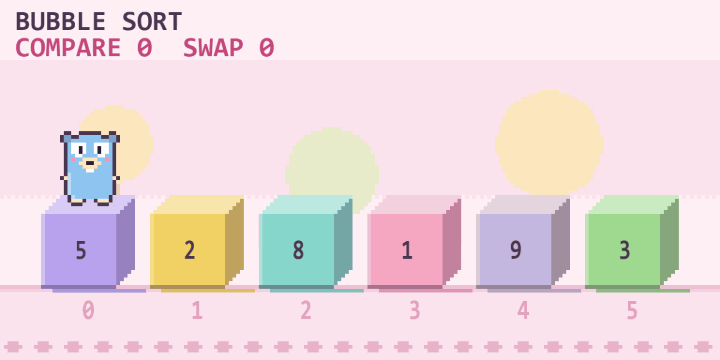

<p align="center"></p>

# GopherViz

**See how your code runs, as a pixel-art game, live while you type.**

GopherViz is a VS Code extension that animates loops, branches, functions, recursion, sorting, searching, classes,
goroutines and the JavaScript event loop in Go, JavaScript, TypeScript, Python, PHP, C++, C and Java. Your code is
simulated, never executed.



**[Read the full extension guide →](vscode-extension/README.md)**

## Install

Search for **GopherViz** in the Extensions view of VS Code, or install it from the
[Visual Studio Marketplace](https://marketplace.visualstudio.com/items?itemName=gopherviz.gopherviz).

## Repository layout

| Path | What it is |
|---|---|
| `cmd/gopherviz` | The `gopherviz` command line program (`list`, `trace`, `serve`) |
| `internal/analyzer`, `internal/lang` | Parsers that turn source code into blocks (Go uses `go/parser`; the other languages have their own parsers) |
| `internal/sim` | The Go simulator |
| `internal/irsim` | The simulator for the other 7 languages |
| `internal/trace`, `internal/scene`, `internal/protocol` | The JSON contracts between the simulator and the extension |
| `testdata` | Example programs with golden traces |
| `vscode-extension` | The VS Code extension: `src` (extension host) and `media` (the pixel-art webview) |

## Build and test

You need [Go](https://go.dev/) 1.25 or newer and [Node.js](https://nodejs.org/) 22 or newer.

```sh
go test ./...                     # simulator and parser tests

cd vscode-extension
npm install
npm test                          # builds the binary for this machine, then runs the Node tests
npm run test:vscode               # integration tests inside a real VS Code
npm run package                   # builds binaries for all platforms and makes the .vsix
```

To try the extension from source, open `vscode-extension` in VS Code and press `F5`.

## License

[MIT](LICENSE). The pixel Gopher is redrawn from the Go Gopher by Renée French, licensed under Creative Commons
Attribution 4.0.
