# GopherViz

**See how your code runs, as a pixel-art game, live while you type.**

GopherViz turns loops, branches, function calls, recursion, sorting, searching, objects, goroutines and the JavaScript
event loop into a little platformer. A Gopher walks through your code step by step: it hops over conditions, drops
down a pipe into every function call, swaps the cubes of an array, explores a maze, and carries return values back up.

- **Live.** The picture updates on every keystroke. Half-written code shows up as a "ghost" block until it is complete.
- **Real values.** After a short pause in typing, GopherViz simulates your program and shows the actual values of
  every variable, every condition (`i < n → 2 < 5 → true`) and every line of output.
- **Safe.** Your code is **simulated, never executed**. No compiler, interpreter or network is needed, and nothing
  leaves your computer.
- **8 languages.** Go, JavaScript, TypeScript, Python, PHP, C++, C and Java.

## Getting started

1. Open a `.go`, `.js`, `.ts`, `.py`, `.php`, `.cpp`, `.c` or `.java` file.
2. Put the cursor inside a function, loop, `if` or `switch`. The GopherViz panel opens beside your editor.
3. Or click **▶ Visualize** above a block, or press `Ctrl+Alt+L` (`Cmd+Alt+L` on macOS).

Use the buttons under the picture to play, pause, step back and forth, or drag the slider. The line the Gopher is
running is highlighted right in your editor.

## What it shows

| | |
|---|---|
| **Recursion**: every call is a new floor, and return values ride back up as coins. 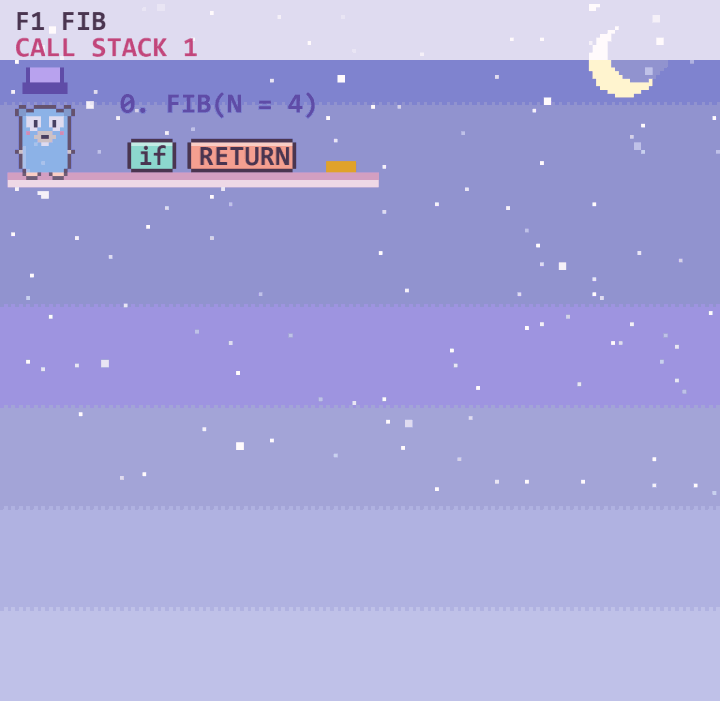 | **Binary search**: the half that can be thrown away slides out of view. 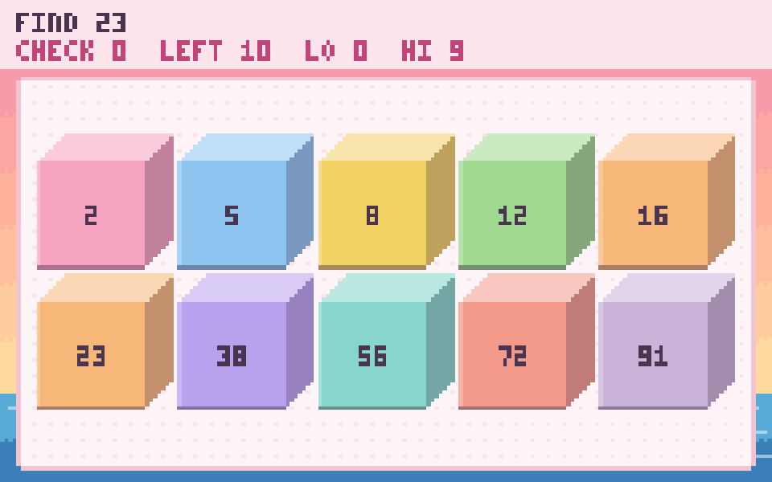 |
| **Mazes and graphs**: BFS and DFS on grids, graphs and trees, with distances and the shortest path. 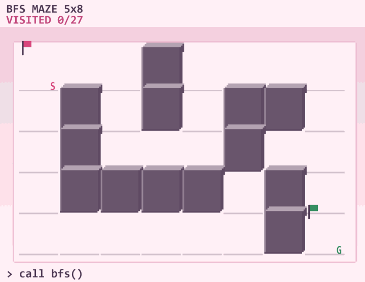 | **Trees**: the Gopher climbs the tree in the order your traversal visits it. 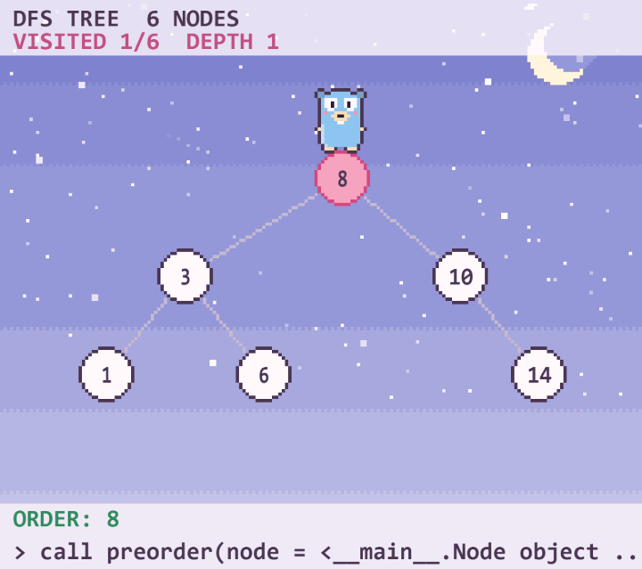 |
| **Classes and objects**: a class is a blueprint, every object is a house, and a method call walks into its house. 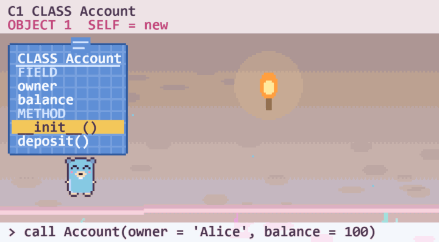 | **if / else and switch**: one floor per branch, and the Gopher takes the first branch that is true. 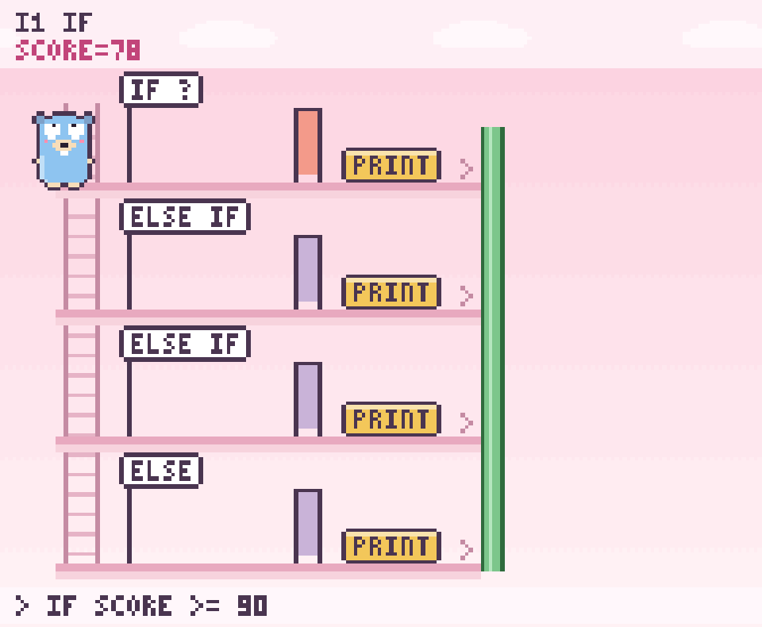 |
| **Goroutines and channels**: one lane per goroutine, channels as pipes, and a clear picture of a deadlock. 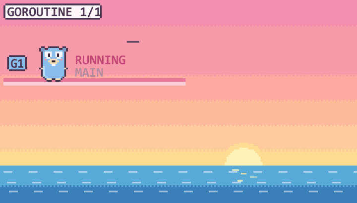 | **JavaScript event loop**: the call stack, the microtask queue and the timer queue, ticket by ticket. 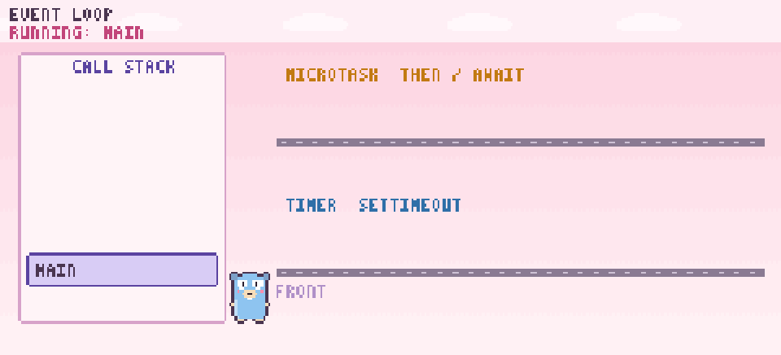 |

Also: sorting algorithms (bubble, selection, insertion, quick, merge and more) with compare and swap counters, stacks
and queues, pointers and memory diagrams, maps, and multi-file programs shown as islands joined by bridges.

### Errors, explained

When a program crashes (index out of range, division by zero, `None`/`null`, a missing key, endless recursion, type
errors, deadlocks), GopherViz plays a short scene of what went wrong and explains it in plain words, with a tip on how
to fix it.

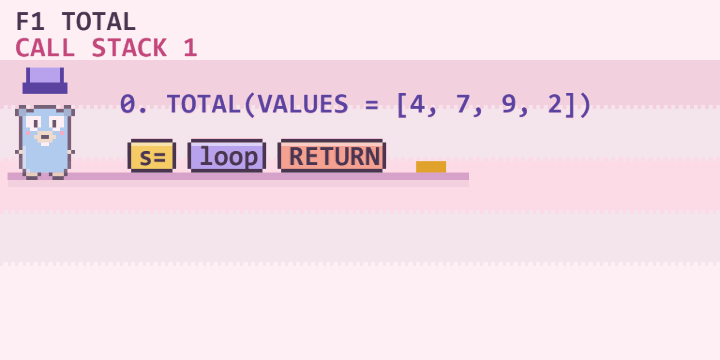

### Guess mode

Press the target button and GopherViz pauses at key moments (up to 5 per run) and asks what happens next: which branch
runs, what a condition evaluates to, what gets printed, what a function returns, or which error is coming.

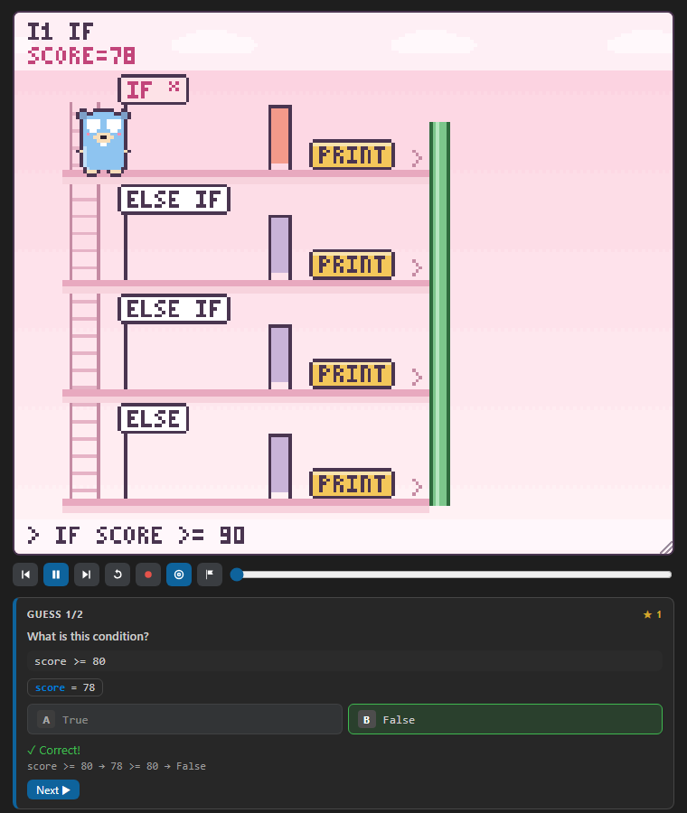

### Algorithm race

Press the flag button, pick two functions, and watch them sort the same random list side by side. A chart then shows
how the work of each one grows as the input gets bigger, with a rough Big-O estimate.

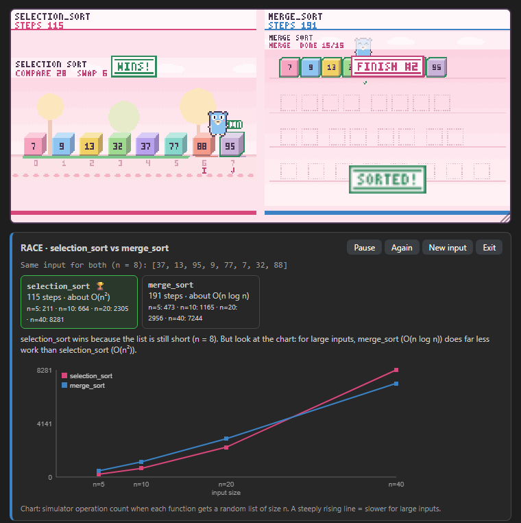

### Record and share

The record button saves the whole animation as a **GIF**, **MP4** or **WebM**: either the stage alone, or a vertical
9:16 reel with a title, your code and the output. MP4 needs [ffmpeg](https://ffmpeg.org/) on your computer.

### Themes and music

Pick a background from the 🎨 menu: **Day**, **Night**, **Cave** or **Beach**, each with its own moving scenery and
chiptune. By default it follows your VS Code theme. Untick **Pixel** for a smooth background, or set your own music
file for each theme.

## Input from the user

When a program reads input (`input()`, `fmt.Scan`, `Scanner`, `cin`, `prompt` and so on), an **Input** box appears in
the panel. Type values separated by commas. Values you leave empty are filled with random numbers from 0 to 100, and
the dice button picks new ones.

## Settings

| Setting | Default | What it does |
|---|---|---|
| `gopherviz.location` | `editor` | Where the panel lives: an editor tab, the sidebar, or the bottom panel |
| `gopherviz.autoOpen` | `true` | Open the panel when the cursor enters a block |
| `gopherviz.realtime` | `true` | Update on every keystroke instead of on save |
| `gopherviz.details` | `false` | Show explanation text, variables, output and the block list next to the picture |
| `gopherviz.highlightLine` | `true` | Highlight the running line in the editor |
| `gopherviz.codeLens` | `true` | Show **▶ Visualize** above every block |
| `gopherviz.speed` | `1` | Animation speed: 0.5, 1, 2 or 4 |
| `gopherviz.size` | `100` | Picture size in percent (you can also drag its bottom-right corner) |
| `gopherviz.sound` / `gopherviz.music` | `true` | Sound effects / background music |
| `gopherviz.theme` | `auto` | `auto`, `day`, `night`, `cave` or `beach` |
| `gopherviz.pixelBg` | `true` | Pixel-art background (off = smooth) |
| `gopherviz.musicFiles` | `{}` | Your own music file per theme, e.g. `{ "night": "C:\\Music\\lofi.mp3" }` |
| `gopherviz.ffmpegPath` | empty | Path to ffmpeg for MP4 recordings, if it is not on your PATH |
| `gopherviz.binaryPath` | empty | Use your own `gopherviz` binary instead of the bundled one |

## How it works

The extension starts `gopherviz serve`, a small program written in Go that ships inside the extension for Windows,
macOS and Linux (x64 and arm64). It parses your code and runs it in a simulator that follows the rules of each
language (integer division, shared slices in Go, Python's `range`, the order of JavaScript's `await`, and so on). The
panel then draws every step.

## Limits

- GopherViz simulates a large, common subset of each language and its standard library, aimed at learning programs.
  Code that depends on files, the network, the clock or libraries it does not know is shown in **structure mode**: the
  flow without real values, together with the reason.
- A trace stops after 1000 loop rounds or 5000 steps, so very long programs are cut short.
- Goroutines are scheduled as if there were one processor, so the order you see is one possible order.

## Credits

The pixel Gopher is redrawn from the Go Gopher by Renée French, licensed under Creative Commons Attribution 4.0.
All sounds and music are generated live with Web Audio.

## License

[MIT](LICENSE)
